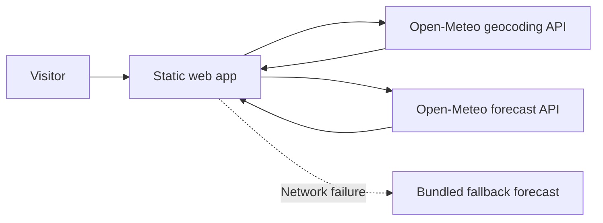
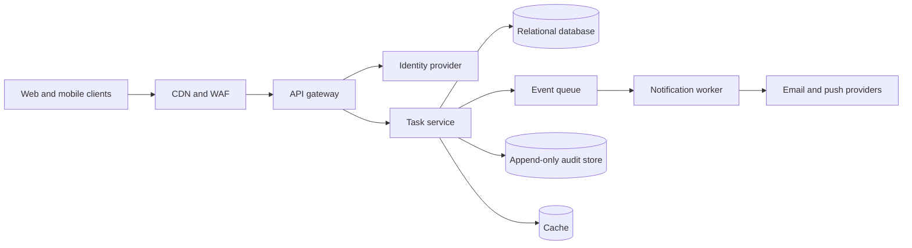
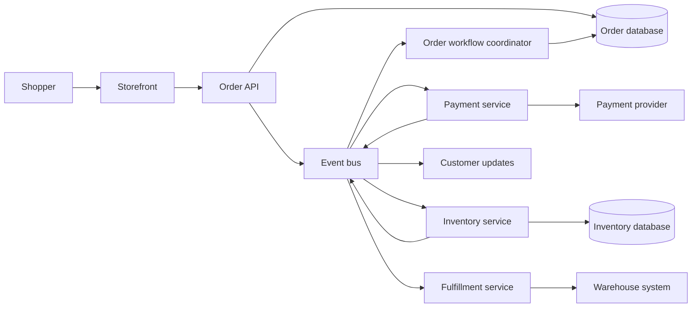

# Solution Architecture Project Samples

Three reference projects showing different architecture patterns. Each sample includes a context diagram, the main design choices, and the concerns an architecture proposal should address.

## 1. Skyline Weather — Serverless Read-Optimized Web App

**Goal:** Let visitors search for a city and see current weather and a five-day forecast, without requiring accounts or API keys.

**Architecture:** Serve a static frontend from a CDN or static hosting provider. The browser calls the geocoding API to resolve a city, then requests forecast data using the returned coordinates. Keep a small bundled fallback so the interface remains useful if either request fails.

**Key decisions**

- No application server, database, account system, or API key is needed for the initial product.
- Keep geocoding and forecast calls in the browser; show clear loading and error states.
- Label fallback values as typical conditions rather than presenting them as live observations.
- Cache static assets at the edge; follow the weather provider's attribution and usage terms.

**Quality attributes:** Fast global delivery, minimal operating cost, graceful degradation, and accessible responsive UI. Monitor provider availability and browser-side request failures; add a backend proxy only if provider policy, rate limiting, or key management requires it.

## 2. Team Tasks — Multi-Tenant SaaS

**Goal:** Provide teams with shared task boards, role-based access, notifications, and an audit trail.

**Architecture:** Use a stateless API and a relational system of record. Every tenant-owned record carries a tenant identifier, and authorization checks tenant membership and role on every operation. Publish domain events to a queue so notification delivery and other slower side effects do not block task updates.

**Key decisions**

- Start with a modular monolith for task and membership logic; split services only when independent scaling or ownership justifies the operational cost.
- Use database constraints and tenant-scoped authorization together; do not rely on client-supplied tenant IDs.
- Make queued work idempotent, retry transient provider failures, and route exhausted messages to a dead-letter queue.
- Keep audit records separate from mutable task state and restrict access to them.

**Quality attributes:** Strong tenant isolation, predictable transactional behavior, resilient notifications, and traceable administrative changes. Define backup/restore objectives, retention policies, rate limits, and per-tenant usage monitoring.

## 3. Shopfront — Event-Driven Commerce

**Goal:** Accept online orders and coordinate payment, inventory, fulfillment, and customer updates without coupling every subsystem to a synchronous request.

**Architecture:** Persist an order before publishing an `OrderPlaced` event through a transactional outbox. A workflow coordinator tracks payment authorization, stock reservation, and fulfillment progress. Services own their data and communicate through versioned events.

**Key decisions**

- Treat order processing as a saga: define forward actions, timeouts, and compensations such as releasing a reservation or voiding an authorization.
- Use idempotency keys for checkout and payment operations; assume messages can be delivered more than once.
- Keep payment card details with a compliant payment provider; store provider tokens and minimal transaction references.
- Provide an order-status read model optimized for customer queries, updated asynchronously from events.

**Quality attributes:** No silent order loss, safe retries, observable workflow state, and bounded recovery time. Alert on stuck orders and growing queue lag; reconcile internal payment and inventory records against provider/warehouse reports.

## Architecture Review Checklist

- **Requirements:** Are the primary user journeys, load assumptions, and service-level objectives explicit?
- **Boundaries:** Are trust zones, ownership boundaries, and external dependencies visible?
- **Data:** Is the system of record clear? Are consistency, retention, backup, and deletion behaviors defined?
- **Security:** Are authentication, authorization, secrets, encryption, and audit requirements addressed?
- **Reliability:** Are timeouts, retries, idempotency, overload behavior, and recovery plans specified?
- **Operations:** Can teams observe errors, latency, saturation, queue lag, and business workflow failures?
- **Tradeoffs:** Does the design explain why its complexity and cost are appropriate for the current scale?
